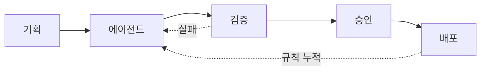

# afteryoon.

Java/Spring 백엔드 · AI 에이전트 운영

**AI가 틀렸을 때 잡히는 구조를 만듭니다**

 

## 숫자로 보면

| 직접 만든 것 | 수 |
|---|---|
| 재사용 스킬 | 20개 |
| 역할이 나뉜 에이전트 | 11개 |
| 스킬 허브 CLI 명령 | 12개 |
| 정해진 시간에 도는 예약 작업 | 9개 |
| 설계 결정 기록 | 약 150건 |
| 사람 검수 시나리오 | 185건 |

직접 센 값입니다. 성과 지표가 아니라 만든 양입니다.

## 일하는 흐름

겪은 문제는 규칙 파일로 남기고, 다음 세션이 시작될 때 자동으로 읽힙니다.

---

### 1. 기획 · 구현 전에 질문부터

| 장치 | 내용 |
|---|---|
| 질문 | 한 번에 3~4개, 추천 답 포함 |
| 기록 | 답은 즉시 기록, 합의 전 구현 금지 |
| 결정 | 이유·대안 함께, 번호는 영구 |
| 일정 | 병렬 기준, 병목은 검수·시험 |

### 2. 에이전트 관리 · 조직처럼

| 장치 | 내용 |
|---|---|
| 구조 | 오너 → PM → 리더 → 실무 |
| 검수 | 리더가 먼저 확인, 저는 결정만 |
| 평가 | 1~5점, 근거는 실패·재작업·환각 |
| 교체 | 같은 가설 3회 실패 시 교체 |
| 인계 | 추측 빼고 로그 사실만 |
| 상태 | 명단·점수판은 파일로 관리 |

### 3. 하네스 · 검증을 절차로

| 장치 | 내용 |
|---|---|
| `verify-sources` | 블라인드 교차검증, 최대 3라운드 |
| `uiux-harness-review` | Claude 측정 → GPT 독립 검토 |
| 판정 | 의견이 갈리면 사람이 확정 |
| 교훈 | 지적 전부 자동 반영 시 자연스러움 하락 |

<b>4. 스킬 관리</b> · 평가 없이는 승격 불가

 

| 장치 | 내용 |
|---|---|
| 승격 | 평가 파일 없으면 `hub promote` 거부 |
| 동기화 | 기기 간 동기화, 충돌은 inbox 보관 |
| 훅 | 세션 시작 시 스킬 주입, 커밋 전 비밀값 차단 |
| Next | 스킬 20개 중 평가셋 대부분 작성 전 |

<b>5. QA</b> · "통과했다"를 증명하게

 

| 장치 | 내용 |
|---|---|
| 수정 전 실패 | 버그마다 실패하는 시험 먼저 |
| 가짜 서버 | 외부 호출 시험, 끊겨도 재호출 안 함 |
| 검수 | 사람 확인 시나리오 185건 |
| Next | 화면 시각 회귀 자동 비교 미도입 |

<b>6. API</b> · 계약 먼저, 자동화는 꺼진 채로

 

| 장치 | 내용 |
|---|---|
| 명세 | OpenAPI 단일 기준, 린트로 강제 |
| 호출 가드 | 허용 호스트·https만, IP 직접 표기 차단 |
| 게시 | 확정 전 카드는 409로 거절 |
| 스케줄러 | 기본값 꺼짐, 켜는 건 사람 |

<b>7. 서버</b> · 롤백 경로 상시 확보

 

| 장치 | 내용 |
|---|---|
| 배포 | VM + Docker Compose, SHA 지정 수동 반영 |
| 롤백 | 직전·지정 SHA 복귀, 마이그레이션마다 되돌리기 파일 |
| SQL 가드 | DROP·TRUNCATE·조건 없는 DELETE 차단 |
| 백업 | 덤프 30일 보존, 백업 나이 점검 |
| AI 접근 | 운영 DB 조회는 읽기 전용 |

<b>직접 만든 도구</b> · 관제실, 아침 브리핑, 예약 작업

 

| 도구 | 하는 일 |
|---|---|
| 에이전트 관제실 | 병렬 세션·결정 대기·일정을 한 화면에 (읽기 전용) |
| 아침 브리핑 | 프로젝트 현황 자동 갱신, 아침에 한 번에 확인 |
| 예약 작업 9개 | 소재 수집·제작·비공개 업로드·파일 정리 |

---

## 기술

저장소는 비공개입니다. 구조와 판단 이유는 설명드릴 수 있습니다. 혼자 쓰는 환경에서 검증했고, 여러 명이 쓰는 조직 도입(교육·권한)은 경험이 없습니다. 규칙이 재발을 얼마나 줄였는지는 아직 측정하지 못했습니다.

---

## 💬 연락

이런 이야기라면 환영합니다. 채용·협업 문의도 같은 곳으로 주세요.

- 에이전트 검수와 책임을 어떻게 나눌지
- LLM 입출력을 실제 호출 없이 시험하는 법
- AI가 운영 서버·DB를 만질 때 맡길 범위
- 반복 업무에서 사람이 승인할 지점

**[연락처 확정 대기]**
