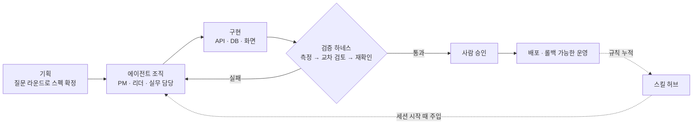

<div align="center">

# afteryoon.

### AI 전환(AX)을 맡긴다면, '틀렸을 때 어디서 잡히는지'부터 설계합니다

Java/Spring 백엔드 출신 · AI 에이전트와 함께 기획부터 API, DB, 서버 운영까지 직접 만들고 운영합니다.
에이전트가 초안을 만들고, 사람이 승인하고, 틀릴 만한 곳에는 미리 검사와 되돌리기를 걸어 둡니다.

[](https://velog.io/@afteryoon)
[](https://solved.ac/khsso10)

</div>

---

<div align="center">
  
  &nbsp;
  <a href="https://solved.ac/khsso10">
    
  </a>
</div>

---

## AX를 이렇게 풀었습니다

AI를 붙이는 것 자체는 어렵지 않습니다. 어려운 건 AI가 섞인 업무가 **틀렸을 때 빨리 발견되고 되돌려지게** 만드는 것입니다. 직접 만든 시스템들을 돌아보니 늘 같은 다섯 가지 질문을 던지고 있었고, 그 순서로 정리했습니다.

| 단계 | 질문 | 제 방식 | 상세 |
|---|---|---|---|
| ① 업무 정의 | 무엇을 AI가 하고, 어디서 사람이 판단하는가 | 구현 전에 질문을 몇 차례 나눠 던져 범위를 확정하고, 결정에 번호를 붙여 남깁니다. 예: 글·카드뉴스 초안은 AI, 게시 승인은 사람 | [1장](#1-기획-구현-전에-질문부터) |
| ② 역할 배치 | 누가 어디까지 하는가 | AI에게도 총괄·분야별 리더·실무 담당 구조를 둡니다. 실무가 한 일은 리더가 먼저 확인하고, 저는 판단이 필요한 것만 받습니다 | [2장](#2-에이전트-관리-조직처럼-굴리기) |
| ③ 검증 | 틀리면 어디서 잡히는가 | AI가 만든 결과를 다른 AI 모델이 다시 검토하는 절차를 두고, 버그 수정에는 고치기 전에는 실패하던 시험을 요구합니다 | [3장](#3-하네스-검증을-절차로-만들기) · [5장](#5-qa버그-검증-통과했다를-증명하게-하기) |
| ④ 사람 승인 | 어느 단계에서 사람의 승인이 필요한가 | 게시·배포·공개는 사람이 켤 때만 나가고, 자동 실행은 꺼진 채로 시작합니다 | [6장](#6-api-엔지니어링) · [7장](#7-서버-관리-ai에게-맡기되-되돌릴-수-있게) |
| ⑤ 자산화 | 배운 것이 남는가 | 겪은 문제를 규칙으로 파일에 남기고, 다음 작업을 시작할 때 AI가 자동으로 읽게 합니다 | [4장](#4-스킬-관리-노하우를-자산으로) · [8장](#8-도구와-자동화-직접-만들어-운영하기) |

**적용 범위.** 이 방식은 AI가 초안을 만들고 사람이 승인하면 되는 반복 업무에 맞습니다. 틀렸을 때 되돌릴 수 없는데 승인할 사람도 없는 업무에는 맞지 않습니다.

**한계.** 위 다섯 단계는 제가 직접 만들고 운영한 시스템에서 나왔습니다. 여러 사람이 일하는 조직에 도입할 때의 교육, 저항 관리, 효과 측정은 이 문서가 아직 보여주지 못하는 부분입니다.

---

## 제가 일하는 방식



위 표가 다섯 가지 질문이라면, 이 그림은 일이 흘러가는 순서입니다. 핵심은 맨 아래 점선, 즉 **스킬 허브로 돌아가는 흐름**입니다. 한 번 겪은 문제는 규칙으로 파일에 남기고, 다음 작업을 시작할 때 자동으로 읽게 했습니다. 같은 실수를 사람의 기억에만 맡기지 않으려는 장치입니다. 다만 이 규칙이 재발을 얼마나 줄였는지는 아직 숫자로 세지 못했습니다.

---

## 1. 기획: 구현 전에 질문부터

- **질문 라운드(grill-plan)**: 한 라운드에 질문 3~4개, 질문마다 제 추천 답을 같이 제시하고, 답은 그 자리에서 기록합니다. 이해가 맞춰지기 전에는 구현에 들어가지 않습니다.
- **결정 기록**: `[결정] [이유] [대안] [선택한 이유]` 형식으로 남기고, 번호는 영구입니다. 결정을 뒤집을 때도 지우지 않고 "새 번호로 대체"라고 씁니다. 나중에 "왜 이렇게 했지?"에 답할 수 있습니다.
- **오너에게는 결정만 요청**: 터미널 작업, 복사, 점검은 에이전트가 하고 사람에게는 판단이 필요한 것만 올립니다.
- **일정은 병렬 기준**: 에이전트가 동시에 하는 작업은 작업일을 단순 합산하지 않고 일정을 잡습니다. 지금까지 병목은 설계·결정·검수·시험에 몰렸습니다.

## 2. 에이전트 관리: 조직처럼 굴리기

한 에이전트에게 모든 일을 맡기면 다룰 맥락이 너무 많아지고 검수가 약해집니다. 그래서 역할과 검수 책임을 회사 조직처럼 나눴습니다.

- **계층**: 오너 → PM → 부서 리더(DB·백엔드·프론트) → 실무 노드. 노드 결과는 리더가 먼저 검수하고, PM이 통합 검수한 뒤 저에게 결정 사항만 올라옵니다.
- **인사카드 필수**: 이름, 직무, 책임, 기억, 협업 방식, 성과 지표를 갖춰야 만들 수 있습니다.
- **평가와 교체**: 동료평가·리더 평가·PM의 부서 평가를 1~5점으로 매기고 근거는 시험 실패·재작업·환각 건수로 남깁니다. 환각, 같은 지적 2회 반복, 지표 하락이 이어지면 교체하고 이전 교훈 3줄만 새 에이전트에게 넘깁니다.
- **디버깅이 맴돌면 세션을 버립니다**: 같은 가설로 3번 실패하거나 6번 실행해도 원인을 못 찾으면 멈추고, 새 에이전트에게 **로그 사실만** 넘깁니다. 틀린 추측이 같이 넘어가는 걸 막기 위해서입니다.
- **조직 상태는 대화가 아니라 파일**에 둡니다. 명단·점수판·변경 기록을 갱신하고, 세션이 시작될 때 훅이 인수인계 문서를 주입해서 끊겨도 이어집니다.
- 상위 모델 자문(디렉터)은 막힐 때만, 호출 이유를 먼저 밝히고, 브리프는 40줄 안으로 씁니다.

## 3. 하네스: 검증을 절차로 만들기

"한 번 더 봐줘"를 매번 말로 하지 않으려고 검증 흐름 자체를 스킬로 만들었습니다.

**`verify-sources` (자료 검색·이차검증 하네스)**
조사 결과를 문서에 쓰기 전에 거치는 7단계입니다. 자료를 모으면 두 검증자가 **주장과 출처만 받아** 각자 검토하고, 서로의 판정은 보지 못합니다. 라운드가 끝나면 사람이 승인하고, 쟁점만 다시 검증해 채택합니다. 최대 3라운드이고, 의견이 갈린 건 검증자가 단독으로 확정하지 않고 사람이 정합니다.

**`uiux-harness-review` (화면·문구 점검 하네스)**
Claude가 화면을 측정하고 문구를 감사하면, GPT가 독립적으로 검토하고, **서로의 지적을 원본으로 다시 확인한 것만** 고칩니다. 둘이 같이 틀리는 경우를 줄이려는 구조입니다. 화면을 바꾸는 모든 작업의 끝에는 6줄짜리 경량 점검을 돌리고, 릴리스 전에는 전체 7단계를 돌립니다.

**하네스 고도화 순환**
출력 → 피드백(제 의견, 내부 검수, 외부 GPT) → 판단(반영·보류·기각) → 기록 → 버전업. 외부 모델에 보내기 전에는 누출 점검을 거치고, 읽기 전용·저장 안 함 호출로 제한합니다.

한 가지 배운 점도 적어둡니다. 점검기가 지적한 대로 문장을 전부 자동 반영했더니 오히려 **자연스러움 점수가 떨어졌습니다.** 그래서 지적은 후보로만 받고, 반영 여부는 판단 단계를 거치게 바꿨습니다.

## 4. 스킬 관리: 노하우를 자산으로

한 프로젝트에서 얻은 요령을 다음 프로젝트에서 다시 발견하는 일이 싫어서, 허브 저장소 하나를 단일 원본으로 두었습니다.

```
hub new       →  staging 에 틀 생성, evals/ 에 평가 사례 작성
hub promote   →  평가 파일이 없으면 승격 거부 (예외는 사유를 기록에 남김)
hub bump      →  이미 있는 스킬은 버전 올릴 때만 수정
hub sync      →  기기 간 동기화, 충돌은 덮어쓰지 않고 inbox 에 보관 → 병합 스킬이 합집합 정리
hub contribute→  lint 통과 후 브랜치+PR (main 병합은 사람이 확인)
```

- **세션 시작 훅**이 "이 작업엔 이 스킬부터"라는 기본 적용표를 주입합니다. 화면 작업이면 접근성·CSS 시스템 스킬을, LLM 입출력이면 보안 점검 스킬을 먼저 읽게 됩니다.
- **커밋 전 훅**이 비밀값, 내 컴퓨터 절대경로, 큰 파일을 막습니다. 실패하면 커밋이 안 됩니다.
- 솔직히 말하면 지금 스킬 20개의 평가셋은 아직 대부분 작성 전입니다. "평가 없이는 승격 못 한다"는 구조는 만들었고, 사례를 채우는 중입니다.

**대표 스킬**

| 스킬 | 하는 일 |
|---|---|
| `llm-io-security-audit` | 프롬프트로 들어가는 값과 모델이 내놓은 값을 **실제 호출 없이** 점검 (주입, 위험 출력, 로그 유출) |
| `llm-response-replay-corpus` | 저장해 둔 모델 응답을 파서·검증기에 다시 넣어, 유료 호출 전에 처리 오류를 찾음 |
| `staged-publisher-fake-fetch-testing` | 컨테이너 생성 → 확인 → 게시처럼 단계가 나뉜 게시 API를 가짜 서버로 시험 |
| `db-seed-reset-rehearsal` | DB 시드를 넣고 되돌리는 연습을 먼저 수행 |
| `craft-webapp-testing` | 화면을 실제로 열어 정렬·접근성·폭별 스크린샷을 측정. 못 돌린 검사는 못 돌렸다고 적음 |

## 5. QA·버그 검증: "통과했다"를 증명하게 하기

- **수정 전 실패를 먼저 보입니다.** 버그 수정에는 "수정 전에 실패하는 시험"을 같이 요구하고, 불가능하면 사유를 적게 합니다.
- **외부 호출은 가짜 서버로 시험합니다.** 정해 둔 답을 순서대로 돌려주고, 정의하지 않은 호출이 오면 시험이 실패합니다. 게시 직전 단계, 응답이 끊겼을 때 **재호출하지 않는지**까지 확인합니다.
- **테스트 층**: 단위(서버·웹·공용 패키지), 임시 DB 위의 통합, E2E, 배포 셸 스크립트 시험. 사람이 보는 검수 시나리오는 185건을 따로 둡니다.
- **문제 누적 규칙**: 제작하다 터진 문제를 `[날짜][항목] 문제 → 규칙` 한 줄로 쌓고, 다음 생성 프롬프트에 자동으로 넣습니다.
- **AI 생성물 규제 기준은 코드 한곳에**: AI 고지 위치와 근거 없는 1인칭 체험담 표현을 하나의 기준 모듈이 검사하고, 어느 경로로 만든 결과든 같은 검사를 지나갑니다. 법률 검토 문서와 코드 기준이 어긋나지 않게 맞춥니다.
- 아직 못 한 것: 화면 시각 회귀의 자동 비교는 도입 전입니다. 지금은 스크린샷 측정과 사람 확인으로 대신합니다.

## 6. API 엔지니어링

- **계약 먼저**: API의 기준은 OpenAPI 명세 한 곳이고, 명세의 누락과 중복은 자동 검사로 막습니다. 서버와 화면은 상태값·달력 계산 코드를 공유합니다.
- **외부 호출 가드**: 허용 호스트만 통과, https 강제, IP 직접 표기 차단, DNS 재확인. 확정되지 않은 카드는 게시 API에서 409로 거절합니다.
- **자동화는 꺼진 채로 시작**: 게시 스케줄러 기본값은 꺼짐이고, 켜는 건 사람입니다.
- **운영 중 모델 호출을 줄이는 설계**: 원문을 상위 에이전트가 미리 정제해 DB에 쌓고, 운영에서는 불러다 쓰기만 합니다. 만화 소재는 호출 0이 목표였고 코드에서 차단·계측합니다. 재사용 가능한 원문 범위는 4등급으로 나눴습니다.

## 7. 서버 관리: AI에게 맡기되 되돌릴 수 있게

- **배포**: VM 한 대에서 Docker Compose로 API·웹·DB 프록시를 운영하고, 앞단에 리버스 프록시를 둡니다. 비밀값은 시크릿 매니저에서 받아 `.env`로 생성합니다. 이미지는 CI가 빌드하고, 반영은 커밋 SHA를 지정한 수동 배포입니다. 자동 배포는 의도적으로 꺼 두었습니다.
- **롤백 경로 상시 확보**: 직전 버전 또는 지정 SHA로 되돌리는 스크립트가 있고, 모든 마이그레이션에 되돌리기 파일을 둡니다. 되돌리기가 불가능한 변경은 "이전 버전으로 서버를 내리고 새 번호로 고친다"는 규칙을 문서화했습니다.
- **위험한 SQL 차단**: 마이그레이션 가드가 DROP, TRUNCATE, 조건 없는 DELETE/UPDATE를 막습니다. 운영 반영은 패키지 해시를 고정한 뒤 사람이 확인하고 실행합니다.
- **백업과 복구**: 덤프를 원격 버킷에 올려 30일 보존하고, 최근 백업의 나이를 확인하는 스크립트가 있습니다. 배포 전 스냅샷과 복구 비교 절차도 런북에 있습니다.
- **DB 이관**: 서버리스 PostgreSQL에서 관리형 DB로 옮기면서 스키마 체크섬 일치를 검증했고, 계정 권한 문제를 만나 기록으로 남겼습니다.
- **AI가 운영 DB를 만질 때**: 조회는 읽기 전용 트랜잭션으로 제한하고, 임시 자격 파일은 쓴 뒤 지웁니다.

## 8. 도구와 자동화: 직접 만들어 운영하기

결과물 하나를 만드는 데서 멈추지 않고, 결과물을 반복해서 안전하게 만들어 내는 도구를 직접 만들어 씁니다.

| 도구·자동화 | 하는 일 |
|---|---|
| **스킬 허브 CLI** | 스킬·에이전트·프롬프트를 한 저장소에서 관리합니다. 동기화, 평가 후 승격, 점검, 기기 세팅을 명령 12개로 묶었습니다 |
| **세션 시작·커밋 전 훅** | 새 작업이 시작될 때 "이 일엔 이 스킬부터"를 자동으로 알려주고, 커밋 전에 비밀값·내 컴퓨터 경로·큰 파일을 막습니다 |
| **에이전트 관제실** | 병렬로 도는 Claude Code 세션, 결정 대기 건, 오늘 일정을 한 화면에 모아 보는 읽기 전용 로컬 앱입니다 |
| **아침 브리핑 허브** | 프로젝트 현황을 자동으로 갱신해 두고, 아침에 어제의 상태와 오늘 할 일을 한 번에 보게 합니다 |
| **예약 작업(9개)** | 영상 소재 수집, 제작, 비공개 업로드, 보관 파일 정리처럼 반복 업무를 정해진 시간에 돌립니다. 자동 승인과 자동 공개는 만들지 않았고, 공개 전에는 사람의 승인을 거칩니다 |
| **교차검증 하네스** | Claude와 GPT가 서로의 결과를 확인하는 절차를 스킬로 만들어, 필요할 때 같은 순서로 돌립니다 |

솔직한 한계도 적습니다. 이 도구들은 대부분 혼자 쓰는 환경에서 검증했습니다. 여러 사람이 함께 쓰게 하려면 사용법 교육과 권한 설계가 더 필요합니다.

---

## 🧪 이 구조로 만든 프로젝트 (모두 비공개)

- **콘텐츠 생성·게시 관리 시스템**: NestJS + Next.js + PostgreSQL. AI가 만든 글·카드뉴스·만화를 사람이 승인해야만 인스타그램·페이스북에 게시되고, 네이버는 복사용 패키지로 내보냅니다. 발행 달력 규칙을 서버 순수 함수로 만들어 테스트로 고정했습니다.
- **영상 제작 파이프라인**: Python(FastAPI). 주제 → 대본 → 장면 → 음성·자막 → 사람 승인 → 비공개 업로드. 자동 승인과 자동 공개는 만들지 않았습니다.
- **에이전트 관제실**: 병렬로 도는 Claude Code 세션의 상태와 결정 대기를 한 화면에 보는 읽기 전용 로컬 앱(Next.js, TypeScript). 비밀값은 키체인에 두고 내 컴퓨터 안에서만 열립니다.

회사 내부용이라 저장소는 공개하지 못하지만, 구조와 판단 이유는 얼마든지 설명드릴 수 있습니다.

---

## 🛠 Tech Stack

**Languages**  


**Backend & Frontend**  


**Data**  


**AI · Infra · Tools**  


---

## 📝 Blog Posts

<!-- BLOG-POST-LIST:START -->
<!-- BLOG-POST-LIST:END -->

<div align="center">

[](https://velog.io/@afteryoon)

</div>

---

## 💬 이런 이야기라면 언제든 환영입니다

- 에이전트 여러 개를 굴릴 때 검수와 책임을 어떻게 나누는지
- LLM 입출력을 실제 호출 없이 시험하는 방법
- AI가 운영 서버와 DB를 만질 때 어디까지 맡기고 무엇을 막는지
- 반복 업무를 AI와 사람 사이에 어떻게 나누고, 사람이 승인할 지점을 어디에 두는지

<!-- 연락처(이메일 등)는 공개 여부를 정한 뒤 이 자리에 추가 -->
