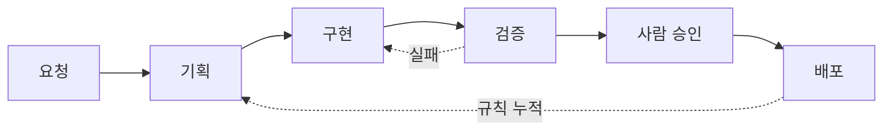

# afteryoon.

Java/Spring 백엔드 개발자 · AX 전환 설계

**현황을 인터뷰·점검해 표준안을 만들고, 자동화로 사람의 리소스를 줄입니다**

 

## 기술

---

## AX 진행 방식

기업의 AX를 맡으면 현재 상태를 듣고 점검해 표준안으로 정리하고, 그 위에 자동화를 얹습니다.

| 단계 | 하는 일 · 남는 산출물 | 줄어드는 사람 일 |
|---|---|---|
| 1. 진단 | 담당자 인터뷰, 현행 업무 점검 · **점검표** | 업무 파악용 회의 |
| 2. 표준화 | 질문으로 범위 확정, 결정 기록 · **업무 표준안** | 같은 질문 반복 답변 |
| 3. 프로세스 | 단계·판단 지점·승인자 설계 · **업무 흐름도** | 담당 정하는 조율 |
| 4. 자동화 | 반복 구간을 도구로 구축, 검증 · **자동화 도구** | 반복 입력·수집·정리 |
| 5. 운영 정착 | 백업·복구, 승인 지점 유지 · **운영 절차서** | 장애·실수 뒤 수습 |

## 구축 규모

지금까지 구축한 자동화·검수 체계의 규모입니다.

| 항목 | 수 |
|---|---|
| 재사용 스킬 | 20개 |
| 역할을 나눈 AI 작업자 | 11개 |
| 스킬 관리 도구 명령 | 12개 |
| 정해진 시간에 도는 예약 작업 | 9개 |
| 설계 결정 기록 | 약 150건 |
| 사람 확인용 검수 시나리오 | 185건 |

## 에이전트 워크플로우

---

## 커밋 먹는 뱀

  <picture>
    <source media="(prefers-color-scheme: dark)" srcset="https://raw.githubusercontent.com/afteryoon/afteryoon/output/github-snake-dark.svg">
    
  </picture>

---

저장소는 비공개입니다. 구조와 판단 이유는 설명드릴 수 있습니다. 여러 명이 쓰는 조직 도입은 해 본 적 없습니다.

## 연락

**[연락처 확정 대기]**
