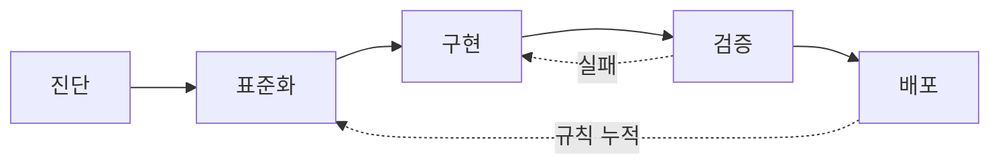

# afteryoon.

Java/Spring 백엔드 개발자 · AX 전환 설계

**현황을 인터뷰·점검해 표준안을 만들고, 자동화로 사람의 리소스를 줄입니다**

 

## 기술

---

## AX 진행 방식

기업의 AX를 맡으면 현재 상태를 듣고 점검해 표준안으로 정리하고, 그 위에 자동화를 얹습니다.

| 단계 | 하는 일 · 남는 산출물 | 줄어드는 사람 일 |
|---|---|---|
| 1. 진단 | 담당자 인터뷰, 현행 업무 점검 · **점검표** | 업무 파악용 회의 |
| 2. 표준화 | 질문으로 범위 확정, 결정 기록 · **업무 표준안** | 같은 질문 반복 답변 |
| 3. 프로세스 | 단계·판단 지점·승인자 설계 · **업무 흐름도** | 담당 정하는 조율 |
| 4. 자동화 | 반복 구간을 도구로 구축, 검증 · **자동화 도구** | 반복 입력·수집·정리 |
| 5. 운영 정착 | 백업·복구, 승인 지점 유지 · **운영 절차서** | 장애·실수 뒤 수습 |

## 구축 규모

지금까지 구축한 자동화·검수 체계의 규모입니다.

| 항목 | 수 |
|---|---|
| 재사용 스킬 | 20개 |
| 역할을 나눈 AI 작업자 | 11개 |
| 스킬 관리 도구 명령 | 12개 |
| 정해진 시간에 도는 예약 작업 | 9개 |
| 설계 결정 기록 | 약 150건 |
| 사람 확인용 검수 시나리오 | 185건 |

## AI 워크플로우 구축

단계를 나누고, 검증에서 실패하면 구현으로 돌아갑니다. 겪은 문제는 규칙 파일로 남겨 다음 작업에 자동으로 적용합니다.

---

### 1. 업무 정의·표준화

| 장치 | 내용 |
|---|---|
| 현황 인터뷰 | 한 번에 3~4개, 권장안 함께 제시 |
| 기록 | 답은 바로 기록, 합의 전엔 구축 보류 |
| 결정 | 이유·대안과 함께 번호로 추적 |
| 일정 | 작업은 병렬, 지연은 검수·시험에서 발생 |

### 2. 자동화 운영 체계

| 장치 | 내용 |
|---|---|
| 역할 | 총괄 · 조율 · 파트 책임 · 실행 4단계 |
| 검수 | 파트 책임자가 먼저 확인, 최종 결정만 제가 담당 |
| 평가 | 1~5점, 근거는 실패·재작업·오답 사례 |
| 교체 | 같은 원인으로 3번 실패하면 담당 교체 |
| 인계 | 추측은 빼고 기록된 사실만 전달 |
| 상태 | 담당 명단·평가표를 파일로 관리 |

### 3. 검증 절차

| 장치 | 내용 |
|---|---|
| `verify-sources` | 서로 결과를 모른 채 교차 검증, 최대 3회 |
| `uiux-harness-review` | 화면 측정 후 다른 모델이 독립 검토 |
| 판정 | 의견이 갈리면 사람이 확정 |
| 교훈 | 지적을 전부 반영하면 부자연스러워져 선별 반영 |

<b>4. 표준 모듈 관리</b> · 평가 기준 없이는 등록 불가

 

| 장치 | 내용 |
|---|---|
| 등록 | 평가 기준 파일이 없으면 `hub promote` 거부 |
| 동기화 | 기기 간 동기화, 충돌본은 별도 보관 |
| 훅 | 작업 시작 시 표준 스킬 자동 적용, 커밋 전 비밀값 차단 |

<b>5. 품질 검증</b> · 통과 여부를 근거로 확인

 

| 장치 | 내용 |
|---|---|
| 재현 시험 | 버그마다 수정 전에 실패하는 시험 먼저 |
| 모의 서버 | 외부 호출 시험, 연결이 끊겨도 중복 호출 안 함 |
| 검수 | 사람 확인 시나리오 185건 |

<b>6. 연동 규칙·안전장치</b> · 명세 먼저, 자동 게시는 기본 꺼짐

 

| 장치 | 내용 |
|---|---|
| 명세 | OpenAPI 단일 기준, 린트로 강제 |
| 호출 제한 | 허용 호스트·https만, IP 직접 표기 차단 |
| 게시 | 확정 전 콘텐츠는 요청 거절(409) |
| 스케줄러 | 기본 꺼짐, 담당자가 승인해야 켜짐 |

<b>7. 배포·복구</b> · 되돌리는 길을 항상 확보

 

| 장치 | 내용 |
|---|---|
| 배포 | VM + Docker Compose, 커밋 SHA 지정 수동 반영 |
| 롤백 | 직전·지정 버전 복귀, 마이그레이션마다 되돌리기 파일 |
| SQL 가드 | DROP·TRUNCATE·조건 없는 DELETE 차단 |
| 백업 | 덤프 30일 보존, 백업 나이 점검 |
| AI 도구 접근 | 운영 DB는 읽기 전용 |

<b>직접 만든 도구</b> · 작업 현황판, 아침 브리핑, 예약 작업

 

| 도구 | 하는 일 |
|---|---|
| AI 작업 현황판 | 진행 중 작업·확인 대기·일정을 한 화면에 (조회 전용) |
| 아침 브리핑 | 프로젝트 현황 자동 갱신, 아침에 한 번에 확인 |
| 예약 작업 9개 | 소재 수집·제작·비공개 업로드·파일 정리 |

---

저장소는 비공개입니다. 구조와 판단 이유는 설명드릴 수 있습니다. Next: 스킬 평가 기준과 화면 시각 회귀 비교는 아직 없고, 여러 명이 쓰는 조직 도입은 해 본 적 없습니다. 규칙이 재발을 얼마나 줄였는지는 아직 측정하지 못했습니다.

## 연락

**[연락처 확정 대기]**
